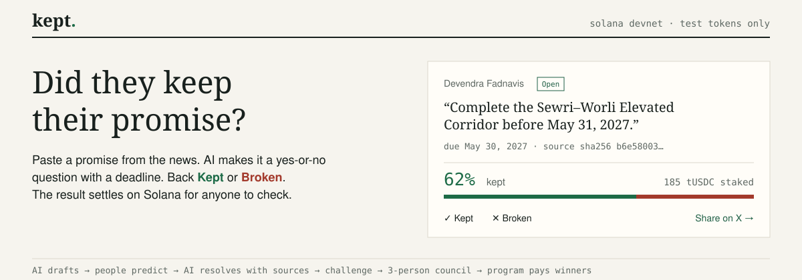
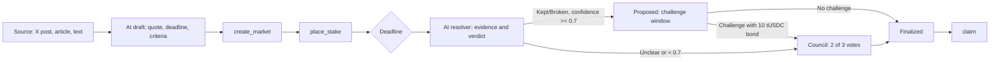

# Kept

A public record of promises on Solana. Paste a promise from the news, turn it into a yes-or-no market with a deadline, let people back Kept or Broken with test USDC, and settle the result on-chain.



[](https://explorer.solana.com/address/GYupVpsMEY12UGgS1gUdabq4UvmbR6PvbmUewQbw7gap?cluster=devnet)
[](https://www.anchor-lang.com/)
[](program/)
[](https://nextjs.org/)
[](https://www.typescriptlang.org/)
[](https://platform.openai.com/)
[](https://tavily.com/)
[](LICENSE)

Built at Hacktoberfest 2026 (GDSC × MLH) at the University of Maryland.

## Overview

Public figures make promises every day, and almost nobody checks back. Kept keeps a verifiable record:

- A promise is stored on-chain with its exact text and a SHA-256 fingerprint of the source, so it survives edits and deletions.
- People stake test USDC (1–100 per person per market) on whether it will be kept. The odds show how credible the promise is before the deadline.
- After the deadline, an AI resolver searches for evidence and proposes a verdict with citations. Anyone with a stake can challenge it, and a three-member council settles disputes.
- The Anchor program holds every stake in a per-market vault and pays winners. There is no admin withdrawal.

Kept runs on devnet with test tokens only.

## How it works



1. **Draft.** The server fetches the source (X oEmbed or article extraction), fingerprints it, and asks the drafter for the promiser, the exact quote, a deadline, and pass/fail criteria. Vague, undated, private-person, or harmful claims are rejected with a reason.
2. **Create.** The reviewed draft becomes a `Market` account with its own token vault.
3. **Predict.** Each wallet can stake once per market. Fees and rent are paid by a server relay, so users never need SOL.
4. **Resolve.** After the deadline, the resolver gathers evidence with Tavily, judges only against the market's criteria, and submits a resolver-signed proposal. Low-confidence or unclear results go straight to the council.
5. **Settle.** An unchallenged proposal can be finalized by anyone after the window. A challenged one is decided by two matching council votes.
6. **Claim.** Winners receive `stake × (total staked + forfeited bonds) ÷ winning side`. Void markets refund every stake.

## Features

- Live feed of dated public commitments from this week's news, each one a click away from a draft
- AI drafting with structured output and guardrails
- On-chain markets, stakes, proposals, challenges, council votes, and claims
- Gasless transactions through a restricted fee-payer relay
- Wallet support through wallet-standard (Phantom, Solflare, Backpack) plus browser test wallets
- Test USDC faucet, personal bets page, forecaster leaderboard, and promiser records
- Share-on-X after placing a prediction
- Solana Actions (Blinks) for staking from dial.to

## Architecture

| Component | Technology | Location |
|---|---|---|
| Program | Rust, Anchor 0.31, SPL Token | `program/` |
| Web app | Next.js 16, React 19, TypeScript, Tailwind CSS | `app/src/app/` |
| Chain client | `@coral-xyz/anchor`, `@solana/web3.js`, wallet-adapter | `app/src/chain/`, `app/src/wallet/` |
| AI | OpenAI Responses API with JSON-schema output | `app/src/server/intelligence/` |
| Sources and search | Tavily, X oEmbed, Mozilla Readability | `app/src/server/context/` |
| Server workflows | Resolver, relay, faucet | `app/src/server/orchestrator/` |

The chain is the system of record; there is no database. API keys and signing keys stay on the server.

### Program

| Instruction | Signer | Purpose |
|---|---|---|
| `initialize_config`, `update_config` | Admin | Resolver key, council members, challenge window, bond |
| `create_market` | Creator and fee payer | New market and vault; text limits keep the transaction under 1,232 bytes |
| `place_stake` | User and fee payer | 1–100 tUSDC, one position per wallet, before the deadline |
| `propose_outcome` | Resolver | Verdict, confidence, summary, sources, evidence hash |
| `challenge` | Staker | Posts the bond during the challenge window |
| `council_vote` | Council member | Two matching votes decide; three different votes void the market |
| `finalize` | Anyone | Settles an unchallenged proposal after the window |
| `claim` | Position owner | Payout, refund, or returned bond |

Program ID (devnet): [`GYupVpsMEY12UGgS1gUdabq4UvmbR6PvbmUewQbw7gap`](https://explorer.solana.com/address/GYupVpsMEY12UGgS1gUdabq4UvmbR6PvbmUewQbw7gap?cluster=devnet)

## Getting started

### Prerequisites

- Node.js 20 or later
- An OpenAI API key and a Tavily API key
- A Solana wallet set to devnet (optional in mock mode)
- WSL or Linux with the Solana and Anchor CLIs, only if you build the program yourself

### Run locally

```bash
cd app
npm install
cp .env.example .env.local    # add OPENAI_API_KEY and TAVILY_API_KEY
npm run dev                   # http://localhost:3000
```

With `NEXT_PUBLIC_CHAIN=mock`, the app runs against in-memory test data and needs no chain setup.

### Use devnet

```bash
npm run keys            # generate fee-payer and resolver keys in .env.local
# fund the fee payer (~1 SOL) and resolver (~0.1 SOL) with devnet SOL
npm run setup:devnet    # create the tUSDC mint and the app config
```

Set `NEXT_PUBLIC_CHAIN=anchor` in `.env.local` and restart the dev server. See [`docs/RUNBOOK.md`](docs/RUNBOOK.md) for the full setup, demo reset, and troubleshooting.

### Configuration

| Variable | Description |
|---|---|
| `OPENAI_API_KEY`, `OPENAI_MODEL` | Drafting and resolution |
| `TAVILY_API_KEY` | Evidence search and the news feed |
| `NEXT_PUBLIC_CHAIN` | `mock` or `anchor` |
| `NEXT_PUBLIC_SOLANA_RPC_URL`, `SOLANA_RPC_URL` | RPC endpoint (a dedicated devnet RPC avoids public rate limits) |
| `NEXT_PUBLIC_PROGRAM_ID`, `NEXT_PUBLIC_TUSDC_MINT`, `NEXT_PUBLIC_CONFIG_ADMIN`, `NEXT_PUBLIC_FEE_PAYER_PUBKEY` | Public chain values written by `keys` and `setup:devnet` |
| `FEE_PAYER_SECRET`, `RESOLVER_SECRET` | Server signing keys; never commit these |
| `COUNCIL_PUBKEYS`, `CHALLENGE_WINDOW` | Used by `setup:devnet` |
| `NEXT_PUBLIC_SITE_URL` | Public base URL for shared links |

## Testing

```bash
cd app
npm run check           # type check and unit tests (offline)
npm run test:e2e        # Playwright UI tests in mock mode
npx tsx scripts/smoke-devnet.ts    # end-to-end money path on devnet; requires the dev server
```

The devnet smoke test funds three wallets that hold no SOL, creates a market, stakes 10 and 15 on Broken and 75 on Kept, proposes Broken, finalizes after the window, and asserts payouts of 40, 60, and 0.

Program tests run against devnet; see [`program/README.md`](program/README.md).

```bash
bash program/build.sh test    # build the program and IDL, run the Rust unit tests
```

## Project structure

```
app/
  src/app/              pages and API routes
  src/chain/            program client, transaction builders, React hooks
  src/server/           sources, AI, resolver, relay, faucet
  src/shared/           types, constants, IDL
  src/wallet/           wallet providers and test wallets
  scripts/              keys, devnet setup, seed, smoke test
  tests/                API and Playwright tests
program/
  src/lib.rs            Anchor program
  tests/                program tests
  build.sh              build and test the program in WSL or Linux
docs/
  RUNBOOK.md            setup, demo reset, troubleshooting
  TEST_CHECKLIST.md     manual checks before a demo
  PLAN.md               the hackathon build plan
  archive/              past PR notes and debugging reviews
assets/                 README images
CLAUDE.md               team rules and roles for Claude Code
```

## API

| Endpoint | Description |
|---|---|
| `POST /api/draft` | Build a market draft from a URL or text |
| `POST /api/resolve/[id]` | Run the resolver for a market past its deadline |
| `GET /api/resolve/[id]` | Read the resolver's research trace |
| `POST /api/relay` | Co-sign an approved, user-signed transaction |
| `POST /api/faucet` | Send 100 tUSDC to a new wallet |
| `GET /api/news` | Recent dated public commitments from news search |
| `GET /actions.json`, `GET/POST /api/actions/stake` | Solana Actions |

## Team

| Area | Contributor |
|---|---|
| Blockchain program and devnet setup | Neil |
| Backend and AI | net-bob |
| Frontend | Noam |
| Wallet, chain client, and Blinks | aaron |

## License

[MIT](LICENSE)
