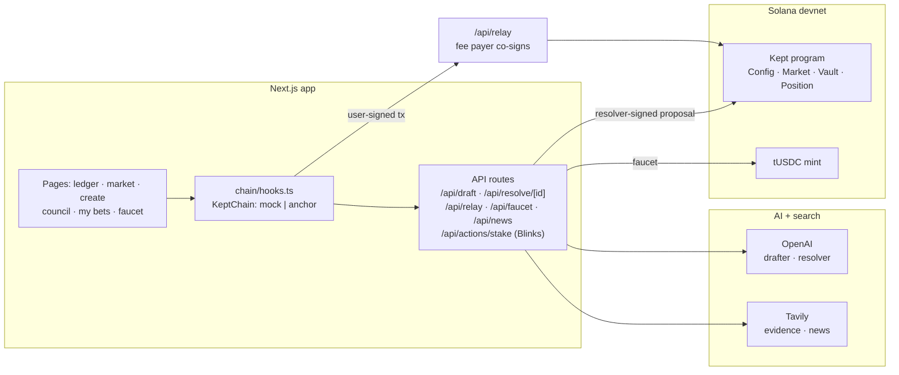

<div align="center">


# Kept: did they keep their promise?

**A public record of promises, with money where the mouth is.**


      
<br/>
    

<sub><b>Hacktoberfest 2026 (GDSC × MLH)</b> · University of Maryland, College Park</sub>

[Why Kept](#-why-kept-exists) · [Features](#-features) · [How it works](#-how-it-works) · [Tech stack](#-tech-stack) · [Tracks](#-tracks) · [Results](#-results) · [Obstacles](#-context-and-obstacles) · [Demo](#-demo-script) · [Impact](#-impact) · [Run it](#-run-it)

**Program (devnet):** [`GYupVpsMEY12UGgS1gUdabq4UvmbR6PvbmUewQbw7gap`](https://explorer.solana.com/address/GYupVpsMEY12UGgS1gUdabq4UvmbR6PvbmUewQbw7gap?cluster=devnet)

</div>

---

## 💡 Why Kept exists

> [!IMPORTANT]
> **Public figures make promises every day, and almost nobody checks back.** Posts get deleted, pages get edited, people forget. There is no simple public record of who keeps their word.

Kept turns any public promise into a **yes-or-no question with a deadline**. People back **✓ Kept** or **✕ Broken** with capped test stakes, so the odds show how believable a promise is *before* the deadline. When the deadline passes, AI researches what happened and proposes a result **with its sources**; anyone who predicted can challenge it, a three-person council settles disputes, and the program pays the winners. The promise, a fingerprint of its source and the result stay on Solana, where nobody can quietly edit or delete them, including us.

| | A tweet or a news quote | **The same promise on Kept** |
|---|---|---|
| Can it disappear? | Deleted or edited anytime | Exact text + **sha256 of the source** on-chain |
| How believable is it? | Opinions in replies | **Live odds** from capped stakes (1–100 tUSDC per person) |
| Did it happen? | Whoever argues loudest | **AI verdict with citations**, challengeable, settled by program rules |
| Track record? | Scattered | A **promiser page** with Kept · Broken · Pending |

---

## ✨ Features

| Feature | What it does |
|---|---|
| 📰 **In the news this week** | A live rail of dated public commitments from news search (social posts, charity "pledges" and sports "deadlines" filtered out); **Track this** opens the create form prefilled |
| ✍️ **Track a promise** | Paste an X post, article URL or text → the source is fetched and fingerprinted → AI drafts who, the exact quote, the deadline and Kept/Broken criteria, or **rejects** vague, private-person or harmful claims with a reason |
| ⛓️ **Create on Solana** | The edited draft becomes a market account with its own vault; the browser lands on the new market |
| 🎯 **Predict** | Back Kept or Broken with 1–100 tUSDC, once per wallet per market; odds and the pool update live |
| 🔎 **AI resolution** | After the deadline, the resolver searches for evidence, judges against the criteria and writes a **resolver-signed proposal** on-chain, with a research trace shown in the UI |
| ⚖️ **Challenge → council** | Stakers can challenge within the window with a 10 tUSDC bond; three council wallets vote and **2 matching votes** decide Kept, Broken or Void |
| 💸 **Claim** | Winners claim `stake × (pool + forfeited bonds) ÷ winning side`; Void refunds everyone |
| 📣 **Share on X** | After a confirmed prediction, one click opens a post with your call, the promise, the deadline and a link back |
| 👛 **Your own wallet** | Phantom, Solflare, Backpack… through wallet-standard, plus up to 10 browser test wallets for demos; **users never need SOL** |
| 🪙 **Get tUSDC** | 100 test USDC once per wallet from the faucet |
| 📒 **My bets · Forecasters · Promisers** | Your positions and claims, a leaderboard, and each promiser's public record |

---

## 🧠 How it works

> **AI drafts and judges. The program holds the money and enforces every rule.**

A model that can move money is a liability, so Kept gives AI **two narrow jobs** (drafting a market and proposing a verdict) and wraps both in code that validates everything they return. Money only moves through an Anchor program: one vault per market, no admin withdraw, and every stake, proposal, challenge and vote is a public transaction.

```mermaid
flowchart LR
    src["📰 X post · article · text"] --> ctx["🔍 Context<br/>oEmbed · readability · sha256"]
    ctx --> draft["🤖 Drafter<br/>exact quote · deadline · criteria<br/>or reject with a reason"]
    draft --> create["⛓️ create_market<br/>market + vault on devnet"]
    create --> stake["🎯 place_stake<br/>1–100 tUSDC, once per wallet"]
    stake --> deadline{"⏰ deadline"}
    deadline --> resolve["🔎 Resolver<br/>Tavily evidence → verdict + citations"]
    resolve -- "Kept/Broken ≥ 0.7" --> proposed["📝 Proposed<br/>30 s challenge window"]
    resolve -- "unclear or < 0.7" --> council
    proposed -- "no challenge" --> final["✅ Finalized"]
    proposed -- "challenge · 10 tUSDC bond" --> council["⚖️ Council<br/>2 of 3 votes"]
    council --> final
    final --> claim["💸 claim"]
```



| Layer | Who | What happens |
|---|---|---|
| **Context** | Server | X oEmbed or article extraction (readability), normalized text, **sha256 fingerprint**; Tavily search for evidence and for this week's news |
| **Intelligence** | OpenAI | Structured JSON output: the drafter quotes the source word for word and names where to check; the resolver judges only the criteria and must cite sources it actually read |
| **Orchestration** | Server | Resolve workflow (read → search → judge → validate → write) with a live trace; gasless relay; faucet |
| **Settlement** | Anchor program | Config · Market · Vault · Position accounts; deadlines, stake limits, challenge window, 2-of-3 council, payout math |
| **Experience** | Next.js | Ledger, market page, create flow, council desk, my bets, wallet connect, share on X |

<details>
<summary><b>📋 Program instructions and rules</b></summary>

| Instruction | Signers | Rule |
|---|---|---|
| `initialize_config` · `update_config` | admin | resolver, 3 council keys, challenge window (30 s demo, 24 h production), 10 tUSDC bond |
| `create_market` | creator + fee payer | deadline in the future; text capped so the transaction fits in 1,232 bytes |
| `place_stake` | user + fee payer | open, before the deadline, 1–100 tUSDC, one position per wallet |
| `propose_outcome` | resolver only | after the deadline; Kept/Broken ≥ 7000 bps → Proposed, otherwise → Council |
| `challenge` | a staker | while the window is open; bond moves into the vault |
| `council_vote` | council members | 2 matching votes decide; three different votes → Void |
| `finalize` | anyone | an unchallenged proposal after the window |
| `claim` | position owner | payout, refund on Void, bond back if the council overturned the AI |

Payout: `stake × (total staked + forfeited bonds) ÷ winning side`, rounded down. Worked example: 10 on Broken, 100 in the market, 25 on Broken → **40 tUSDC**.

</details>

<details>
<summary><b>🏗️ Architecture</b></summary>



The chain is the database. Keys (OpenAI, Tavily, fee payer, resolver) live only on the server.

</details>

---

## 🧰 Tech stack

| Layer | Technology | Where |
|---|---|---|
| Program | Rust, Anchor 0.31 (CLI 0.31.2), Agave 2.3.13 platform tools, SPL Token | `program/` |
| Chain client | `@coral-xyz/anchor`, `@solana/web3.js` v1, `@solana/spl-token`, typed IDL | `app/src/chain/`, `app/src/shared/idl/` |
| Wallets | `@solana/wallet-adapter` (wallet-standard: Phantom, Solflare, Backpack), browser test wallets | `app/src/wallet/` |
| AI | OpenAI Responses API with JSON-schema output and reasoning effort per task | `app/src/server/intelligence/` |
| Search | Tavily (evidence + news), X oEmbed, Mozilla Readability + linkedom | `app/src/server/context/` |
| App | Next.js 16 (App Router), React 19, TypeScript, Tailwind, Sonner | `app/src/app/` |
| Blinks | Solana Actions (`@solana/actions`), `actions.json`, dial.to | `app/src/app/api/actions/` |
| Tests | Vitest (unit + API), Playwright (UI), Anchor tests on devnet, `smoke-devnet.ts` | `app/`, `program/tests/` |

---

## 🏆 Tracks

### 1. Solana Partner Challenge

**What we built on Solana:**
- **Program-owned vaults:** one SPL token vault per market whose authority is the market PDA. There is **no admin withdraw** instruction; money only leaves through `claim`.
- **Every step is a transaction:** market creation (with the source fingerprint), stakes, the resolver-signed proposal, challenges, council votes and claims are all on [devnet Explorer](https://explorer.solana.com/address/GYupVpsMEY12UGgS1gUdabq4UvmbR6PvbmUewQbw7gap?cluster=devnet).
- **Gasless for users:** a server fee payer co-signs, but only transactions that call approved Kept instructions (create, stake, challenge, vote, finalize, claim), with one market instruction per transaction, bounded compute settings and the user's signature present. A SystemProgram transfer that would drain the fee payer is refused.
- **Built for Solana's limits:** promise, criteria and URL lengths are capped so `create_market` stays under the 1,232-byte transaction limit (~1,050 bytes at the maximum).
- **Blinks:** any market can be staked from a Solana Action on dial.to.

### 2. Tech for Good

**The need:** voters, customers and communities have no simple way to hold public figures to their word. **What Kept does about it:**
- **Remembers:** each promise is saved with its exact text and a fingerprint of the source, so it survives deletion.
- **Measures trust:** capped stakes (100 tUSDC per person per market) mean no rich account, and no promiser, can buy the odds.
- **Checks results with evidence:** the AI must cite what it read; below 0.7 confidence it doesn't decide; humans can always challenge.
- **Guardrails:** public figures and organizations only. The drafter rejects private individuals, vague or undated claims, and anything about death or harm before a market can exist.
- **No real money:** devnet and test tokens only, labeled on every page.

---

## 📊 Results

**The full money path on real devnet** (`npm run smoke:devnet`, three wallets holding **0 SOL**):

| Step | Result |
|---|---|
| Faucet × 3 | 100 tUSDC each, no SOL needed |
| Create market + stakes | A 10 Broken · B 15 Broken · C 75 Kept → totals **75 / 25** |
| Failure paths | Second stake, stake of 101, early finalize: **all refused** |
| Propose → window → finalize | Broken, window enforced on the chain clock |
| Claims | **A +40 · B +60 · C 0**, double claims refused |
| Time | **71 s**, fully gasless |

<table>
<tr>
<td width="50%" valign="top">

**⛓️ Program on devnet**

| Measure | Value |
|---|---:|
| Program size | 411 KB |
| Deploy rent | 2.09 SOL (refundable) |
| `create_market` tx at max text | ~1,050 / 1,232 bytes |
| Program tests on devnet | **5 / 5** |
| Rust unit tests | **5 / 5** |

</td>
<td width="50%" valign="top">

**🤖 AI drafting, live example**

| Field | Draft |
|---|---|
| Source | IANS via NewKerala, Oct 5, 2026 |
| Decision | ✅ accept |
| Promiser | Devendra Fadnavis |
| Question | Sewri–Worli Elevated Corridor open before May 31, 2027? |
| Check source | MMRDA notices + reputable news |

</td>
</tr>
</table>

**Engineering quality**

| Check | Result |
|---|---|
| App (`vitest`) | **171 passed** in 16 files: chain decoding, payout mirror, PDAs, relay security, drafter and resolver guardrails, news filters, share text, API client, draft route |
| Relay security | 7 offline tests: wrong fee payer, SystemProgram drain, `propose_outcome` through the relay, missing signature, huge priority fee, bundled instructions |
| UI (`playwright`) | Create flow, ledger and guide specs in mock mode with a test wallet |
| Program | Worked example (+40), bad stakes, low confidence → council → Void refunds, overturned challenge returns the bond, late challenge refused |

---

## 🧗 Context and obstacles

Four of us built Kept in one day on Windows laptops, split into four lanes (program, backend + AI, frontend UI, wallet + chain client) on parallel branches. What got in the way, and what we did about it:

| Obstacle | What happened | What we did |
|---|---|---|
| **No Anchor experience, no Rust toolchain** | Windows blocked newly built unsigned binaries, so local `cargo` builds failed | Built in WSL with official Agave and Anchor release binaries; one `program/build.sh` reproduces the build |
| **Solana toolchain vs. new crates** | `blake3` 1.8 pulls `digest` 0.11 (Rust 2024), which the platform tools' cargo 1.84 can't parse | Resolve dependencies with `rust-version = 1.79` and pin `blake3 = 1.5.5` in the build script |
| **Devnet deploy failed halfway** | "Max retries exceeded" while writing 411 KB | Reclaimed the buffer's SOL, retried with a priority fee and more sign attempts |
| **Rate-limited public RPC** | 429s made deadline-based tests flaky and spammed the dev console | Tests wait on the **chain clock**, not wall time; the home page shares one market poll |
| **Wallet dropped on reload** | React StrictMode's second auto-connect returned early without emitting `connect` | The test wallet always emits `connect`; found with a Playwright reproduction |
| **Two people built the same relay** | Backend and blockchain lanes wrote a faucet and relay in parallel | Kept the stricter relay (instruction allowlist, one instruction, signer checks) and rewrote the tests against it |
| **Merging four lanes** | Add/add conflicts from the scaffold and overlapping pages | Merge `main` before every task; every handoff checked by the person receiving it; one owner per file |
| **Contract changes mid-build** | A public token-weighted vote would have changed every lane's types after the IDL freeze | Kept the 3-person council for the demo; the voting program is written and unit-tested on `p1/public-vote` as the next step |
| **Dev server state** | Switching branches under a running server corrupted its cache; a stray `npx next` ran from the repo root | Stop the server before switching, clear `.next`, start the app's own Next binary |

---

## 🎬 Demo script

1. **Home** → the masthead, on-chain totals, and **In the news this week**.
2. **Track this** on a story → **Generate AI draft** → read the quote, deadline and criteria → paste a vague post to see a **rejection with a reason**.
3. **Create on Solana** → approve in the wallet (**0 SOL**) → open the market and its Explorer link.
4. Two wallets back **Kept** and **Broken** → the odds bar moves → **Share on X**.
5. A seeded market past its deadline → **Run resolution** → the research trace and the on-chain proposal → the 30-second challenge window.
6. **Challenge** with the bond → **Council** desk → two council wallets vote → settled.
7. **My bets** → **Claim** (10 × 100 ÷ 25 = **40 tUSDC**) → the promiser's record updates.

---

## 🌍 Impact

<table>
<tr>
<td width="33%" valign="top">

### For the public
A permanent, searchable record of **who keeps their word**, with odds before the deadline and evidence after it, open to anyone, with no account needed to read.

</td>
<td width="33%" valign="top">

### For journalists and watchdogs
Every promise carries its **source fingerprint**, every verdict its **citations**, and every dispute its **council votes**, all independently verifiable on-chain.

</td>
<td width="33%" valign="top">

### For AI with consequences
A reusable pattern: **AI proposes, people can challenge, a program enforces.** The model never holds funds, and low confidence hands the decision to humans.

</td>
</tr>
</table>

**Next steps:** a public, token-weighted vote in place of the fixed council (written on `p1/public-vote`); promiser pages from verified handles; mainnet with a stablecoin once the dispute process is proven.

---

## 🚀 Run it

```bash
cd app && npm install
cp .env.example .env.local     # add OPENAI_API_KEY and TAVILY_API_KEY
npm run dev                    # http://localhost:3000 (NEXT_PUBLIC_CHAIN=mock works with no chain setup)
npm run check                  # typecheck + unit tests, offline
```

**Real devnet:**

```bash
npm run keys                   # fee payer + resolver keys into .env.local (fund them: ~1 SOL / ~0.1 SOL)
npm run setup:devnet           # tUSDC mint + app config (resolver, COUNCIL_PUBKEYS, 30 s window)
# set NEXT_PUBLIC_CHAIN=anchor, restart, then:
npm run smoke:devnet           # full money path, asserts +40
```

Full steps, fallbacks and demo reset: [`docs/RUNBOOK.md`](docs/RUNBOOK.md).

<details>
<summary><b>⛓️ Program</b></summary>

```bash
bash program/build.sh test     # WSL / Linux: builds kept.so + IDL, runs the Rust unit tests
```

Deploy and upgrade steps: [`program/README.md`](program/README.md).

</details>

<details>
<summary><b>🔌 API</b></summary>

| Endpoint | Purpose |
|---|---|
| `POST /api/draft` | URL or text → source record + AI draft (or a rejection with a reason) |
| `POST /api/resolve/[id]` · `GET /api/resolve/[id]` | Run the resolver after the deadline · read its research trace |
| `POST /api/relay` | Co-sign an approved, user-signed Kept transaction as fee payer |
| `POST /api/faucet` | 100 tUSDC once per wallet |
| `GET /api/news` | This week's dated public commitments from news search (cached) |
| `GET/POST /api/actions/stake` · `GET /actions.json` | Solana Actions (Blinks) |

</details>

---

## 👥 Team

| Lane | Who |
|---|---|
| P1 · Blockchain (program, devnet setup) | Neil |
| P2 · Backend + AI | net-bob |
| P3 · Frontend UI | Noam |
| P4 · Wallet, chain client, Blinks | aaron |

<sub>Devnet and test tokens only. Kept is a hackathon prototype, not a financial product.</sub>
